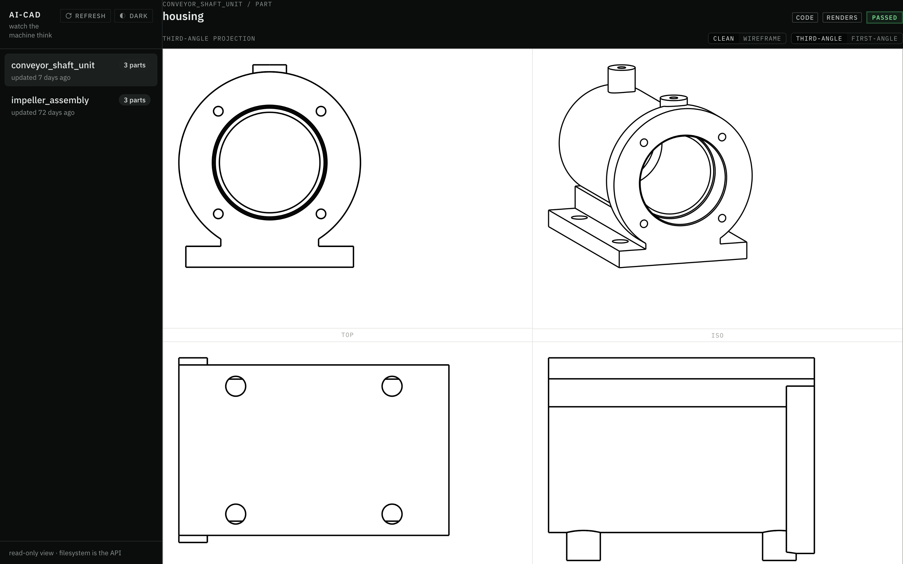

<div align="center">


# AI-CAD Labs

</div>

An open-source organization building the autonomous mechanical-engineering department:
the harness that runs it, the gallery of its real design runs,
and the lineage they grew out of.

[The Flagship Repo](https://github.com/ai-cad-labs/ai-cad) |
[The Repos](#the-repos) |
[Runs Gallery](#design-runs-gallery) |
[Case Study](#case-study) |
[Live Dashboard](#live-dashboard) |
[Quickstart](https://github.com/ai-cad-labs/ai-cad#get-exploring--quickstart) |
[Discussions](https://github.com/ai-cad-labs/ai-cad/discussions)

---

## [AI-CAD](https://github.com/ai-cad-labs/ai-cad) : Our Flagship Repo

**An OSS multi-agent harness for Mech. Eng. CAD**

_AI-CAD is an autonomous engineering department you commission,_

_AI-CAD is not a CAD modeling tool you operate._

Give it a plain-English brief or a hand-drawn sketch,
and a team of LLM agents delivers real, manufacturable parts and assemblies:

- **Plans** : the machine and decomposes it into parts
- **Writes** : parametric [CadQuery](https://github.com/CadQuery/cadquery) Python code
- **Renders** : every part to engineering views, and **looks** at them
- **Critiques** : the geometry against design-for-manufacturing and design-for-assembly rules
- **Repairs** : and re-judges until the design **survives review and delivers your intent**

_Agents **looking** at what they built, and **argue about it** until it **survives review** and **delivers your intent**_

All of this interactively inside your coding agent of choice,
and with visibility in a [**live dashboard**](#live-dashboard).

Every run writes a simple directory of files
that you can read, diff, and version like any other engineering record.

There is **no server** and **no database**.
AI-CAD is built on top of your **coding-agent**.

<div align="center">


_Your engineering department at work:
parts land as agents deliver, verdicts post,
and the [activity waterfall](#live-dashboard) traces every agent in real time.
(This and the drawing-sheet views below are from the
[`conveyor_shaft_unit`](https://github.com/ai-cad-labs/ai-cad-example-projects/tree/main/conveyor_shaft_unit) run,
a two-bearing shaft support unit designed from one paragraph of text;
the shaded cover image further down is the
[`impeller_assembly`](https://github.com/ai-cad-labs/ai-cad-example-projects/tree/main/impeller_assembly) run.)_

</div>

---

## The repos

| Repo | What it is |
|---|---|
| [**ai-cad**](https://github.com/ai-cad-labs/ai-cad) | **The flagship. Start here.** A Claude Code multi-agent CAD harness: planning, CAD design, validation, manufacturability review, and assembly negotiation agents collaborate over [CadQuery](https://github.com/CadQuery/cadquery) to design real parts and assemblies. |
| [**ai-cad-example-projects**](https://github.com/ai-cad-labs/ai-cad-example-projects) | The run gallery: complete, unedited design runs with narrative logs, drawings, and exports. See it work before you run it. |
| [**ai-cad-pydanticai**](https://github.com/ai-cad-labs/ai-cad-pydanticai) | The predecessor implementation (PydanticAI), preserved as a point-in-time research artifact. |

**Ready to run one?**
Clone [**ai-cad**](https://github.com/ai-cad-labs/ai-cad)
and follow its [quickstart](https://github.com/ai-cad-labs/ai-cad#get-exploring--quickstart).

---

## Guiding Design Principles

### Defends design intent

    The system refuses generic manufacturing advice
    that contradicts the intent and machine goals.

(See [the run that argued back](#case-study).)

### Manufacturability is a hard gate, not an afterthought

    A DFM/DFA rulebook scores each design;
    repair proposals that worsen the score are automatically rejected
    by a regression gate with full traceability.

### Agents that see

    Every part and assembly is rendered to 8 engineering views
    (front / top / right / iso, in wireframe and clean styles).

    A vision-capable evaluator agent sees those renders:
    geometry is judged from engineering lenses, not just executed.

### Design machine components as stateful Python code (not immutable mesh props)

    Unlike most text-to-3D tools that generate meshes
    (excellent for game assets and concept art),

    AI-CAD writes parametric CAD code:
    every part is a Python program with named dimensions,

    exporting STEP and STL that a machine shop or downstream CAD system accepts.

### Harness-agnostic

    Canonical agent, skill, and tool content lives once in `.shared/`;
    each harness (`.claude/`, `.opencode/`) is a thin symlinked shell over it.

### The filesystem is the API

    Every run writes a self-describing project directory:
    goals, design log, per-part geometry, negotiation records, reflections.
    Exports STEP and STL for every part.
    No opaque database for facts to hide behind:
    the frontend, replay, and analysis all read the same files.

### Deterministic tool layer

    Geometry execution, rendering, DFMA evaluation, spec validation, dimension checks, and export
    are deterministic bash-callable Python tools.

    Validation happens independently of any LLM.

### Mortality-proof orchestrator

    If the orchestrator agent is killed, or runs out of context window,
    a fresh one reconstructs all state from the project directory alone.

    That is also how a crashed run resumes: no checkpoint database needed.

### Runs debrief themselves

    A run reaches terminal state by writing a structured `run_reflection.md`:
    what failed, what the run improvised to protect the result,
    and what would make the next run smarter.
    Agentic telemetry ships judgment, not just logs.

---

<div align="center">



_Eight views per part, judged like a drawing sheet:
this is what the vision evaluator sees before any geometry ships.
The part is the grey-iron housing of the conveyor shaft unit;
its bores, shoulders, wall and bolt pattern were each measured on the solid._

</div>

---

<a name="live-dashboard"></a>

## Live Dashboard : Watch the machine think

<div align="center">


_Three hours of autonomous design, traced live:
the agent waterfall above,
the shaft, housing, cover, two bearings and twelve fasteners taking shape in four engineering views._

</div>

A read-only local dashboard renders live runs:
drawing sheets, assembly negotiations, and a live agent activity waterfall.
It ships with the [flagship repo](https://github.com/ai-cad-labs/ai-cad)
and reads the run's files directly: the filesystem is the API.

---

## Design Runs Gallery

Real, unedited design runs live in the public gallery:
[`ai-cad-labs/ai-cad-example-projects`](https://github.com/ai-cad-labs/ai-cad-example-projects).
Every run ships its spec, plan, step-by-step design log, per-part geometry,
multi-view renders, STEP/STL exports, and its own debrief.
No geometry there was human-authored.

| Run | What it built | The numbers | Wall clock |
|---|---|---|---|
| [`impeller_assembly`](https://github.com/ai-cad-labs/ai-cad-example-projects/tree/main/impeller_assembly) | A belt-driven centrifugal compressor core, from a hand-drawn sketch ([the case study](#case-study)) | 6 components (3 designed, 3 catalog) · 0.8000 mm clearance measured five ways · 6 backswept blades at 10.5° · reviewer verdict: ship | ~2h12m |
| [`conveyor_shaft_unit`](https://github.com/ai-cad-labs/ai-cad-example-projects/tree/main/conveyor_shaft_unit) | A two-bearing conveyor shaft support unit, from one paragraph of text ([the second case study](#case-study-2)) | 3 designed parts right first time · 9 catalogue items · 136-pair interference sweep · 0 valid gate rejections · reviewer verdict: ship, then downgraded by the run's own verification to pause-for-human with three installation defects named | ~3h after planning (5h31m total, 1h55m lost to a bad network link) |
| [`piston_crank`](https://github.com/ai-cad-labs/ai-cad-example-projects/tree/main/piston_crank) | The 5-part IC-engine core at top-dead-center | 7-instance assembly · a locked dimension chain that held end-to-end · mid-run self-checkpoint and cold resume | 71.3 min |
| [`spur_gear`](https://github.com/ai-cad-labs/ai-cad-example-projects/tree/main/spur_gear) | A meshing involute gear pair | Deterministic mesh proof: 0.00 mm³ interference at the correct half-tooth phase · 0 repair cycles | ~49.8 min |
| [`treasure_chest`](https://github.com/ai-cad-labs/ai-cad-example-projects/tree/main/treasure_chest) | The control baseline: a 4-part chest | 13 agents, 0 failures, 0 repairs · 3 findings deferred with written reasoning | 32.8 min |

<a name="case-study"></a>

<details>
<summary>
<h2>Case Study : Impeller Assembly : the run that argued back</h2>

<div align="center">


**Designed end-to-end from a single hand-drawn sketch:**
_a six-component impeller rig assembly,
rendered from the design run's assembly geometry._

Details: the [`impeller_assembly`](https://github.com/ai-cad-labs/ai-cad-example-projects/tree/main/impeller_assembly) run in the public gallery.

</div>

</summary>

The best argument for the architecture is a run where the system
disagreed with its own tooling and was right.
Every claim below is on file in the public exhibit:

[`impeller_assembly`](https://github.com/ai-cad-labs/ai-cad-example-projects/tree/main/impeller_assembly).

The input was a hand-drawn cross-section sketch and a five-bullet brief:
a belt-driven centrifugal compressor core with backswept blades.

Moments from that run show what a manufacturing gate with judgment looks like:

- **The system defended the user's design intent against its own evaluator.**
  Mid-run, the DFM evaluator (judging the wheel under a mis-selected
  3-axis milling ruleset) recommended cutting the impeller to 4 blades
  and straightening them into flat radial walls.
  That advice would have quietly destroyed exactly what the brief asked for.
  Both orchestrator generations refused it,
  recorded the refusal in `open_issues.md`,
  and passed an explicit do-not-comply guard downstream
  so no later agent could obey it by accident.
- **The headline requirement shipped as a machined dimension.**
  The brief asked for 0.5 to 1.0 mm of running clearance;
  the run delivered 0.8000 mm,
  confirmed by five independent measurements
  and realized structurally in a part,
  not left to an assembly stack-up that can drift.

User intent held as a first-class constraint,
not one voice in a negotiation the tooling usually wins.
The full record, refusals included, is public and unedited:

  6 STEP/STL exports,
  fourteen agent spawns across 2 sessions,
  roughly 2h12m of autonomous work, one repair cycle,
  reviewer verdict: ship.

The complete provenance chain,
from sketch to brief to per-part geometry to the run's own debrief,
is public:
[`impeller_assembly`](https://github.com/ai-cad-labs/ai-cad-example-projects/tree/main/impeller_assembly)
[`run_reflection.md`](https://github.com/ai-cad-labs/ai-cad-example-projects/blob/main/impeller_assembly/run_reflection.md).

[Read the full exhibit](https://github.com/ai-cad-labs/ai-cad-example-projects/tree/main/impeller_assembly) | [Browse all runs](https://github.com/ai-cad-labs/ai-cad-example-projects)

</details>

<a name="case-study-2"></a>

<details>
<summary>
<h2>Case Study : Conveyor Shaft Unit : the run that caught itself</h2>

<div align="center">


**Designed end-to-end from one paragraph of text, no sketch:**
_a 40 mm conveyor shaft on two 6208 bearings in a cast two-bore housing with a bolted seal cover,
rendered from the design run's assembly geometry._

Details: the [`conveyor_shaft_unit`](https://github.com/ai-cad-labs/ai-cad-example-projects/tree/main/conveyor_shaft_unit) run in the public gallery.

</div>

</summary>

The impeller shows the system defending the user against its tooling.
This run shows the other half of a manufacturing gate with judgment:
clean work, and then the system refusing to call it finished.
Every claim below is on file in the exhibit.

The brief was one paragraph:
shaft diameter, speed, loads, service life, bearing size, fits, chamfers, a minimum wall, a grease nipple reachable from above.

- **Three parts, right first time, and no repair loop.**
  The shaft, the housing and the cover each executed on the first attempt
  (each from one closed profile the lead engineer agent resolved from the plan);
  the two repairs in the whole run were one-constant changes,
  the regression gate never validly rejected anything, and no two agents conflicted.
  Every dimension the brief named was measured on the finished solid:
  Ø40.000 seats, Ø80.000 bores on one axis, an 18.000 mm bearing clamp, 1.500 mm of float, an 8 mm wall 99.7 % intact.
- **Sourcing found what geometry cannot.**
  Catalogue arithmetic put the specified bearing's life at 14,094 hours against the 20,000 the brief asked.
  The system kept the customer's bearing, costed three resolutions and marked the question for a human
  rather than silently moving a number the brief had fixed.
- **A clash found by asymmetry, fixed with one constant, defended against a faulty checker.**
  The interference sweep found a flange clipping two foot-bolt heads by 6.4 mm³ while the mirror pair read exactly zero.
  One constant fixed it.
  The regression gate then rejected the fix after comparing the proposal against itself;
  the lead engineer overrode the verdict on four measured grounds and re-proved the fix from independent code.
- **Then it caught itself.**
  The sign-off reviewer said ship.
  The manufacturing review, still running, came back with two installation defects;
  the run's own verification pass confirmed both from scratch,
  found a third by questioning its own first draft
  (the brief's 1 mm chamfer cannot seat a bearing with a 1.1 mm corner radius),
  and downgraded the verdict in writing, with the numbers.

A system that can say "not yet" with evidence is worth more to a workshop than one that only says yes.
The full record, downgrade included, is public and unedited:

  3 designed parts, 9 catalogue items,
  fifteen agent spawns in one session,
  two repair cycles, zero valid gate rejections,
  reviewer verdict: ship; effective status: pause for a human, three defects named.

[Read the full exhibit](https://github.com/ai-cad-labs/ai-cad-example-projects/tree/main/conveyor_shaft_unit) | [Browse all runs](https://github.com/ai-cad-labs/ai-cad-example-projects)

</details>

---

## Getting help

The canonical help page is
[**SUPPORT.md**](https://github.com/ai-cad-labs/.github/blob/main/SUPPORT.md).
The short version:

- **Questions and problems**: open an issue on
  [github.com/ai-cad-labs/ai-cad](https://github.com/ai-cad-labs/ai-cad/issues).
- **"What should healthy output look like?"**: study a complete run in the
  [run gallery](https://github.com/ai-cad-labs/ai-cad-example-projects).
- **Conventions and internals**:
  [`AGENTS.md`](https://github.com/ai-cad-labs/ai-cad/blob/main/AGENTS.md)
  is the canonical map for anyone (human or agent) working in the flagship repo.

## Contribution Invitation

Contributions are welcome, and we want you to feel welcome making them.

You do not need to be a CAD veteran
or a machine-learning engineer to have a big impact:
documentation, DFM/DFA rule improvements, gallery runs,
and issue reports all move the project forward.

| Channel | Best for |
|---|---|
| [Issues](https://github.com/ai-cad-labs/ai-cad/issues) | Bugs and defects |
| [Discussions](https://github.com/ai-cad-labs/ai-cad/discussions) | Show your runs, ask questions, propose machines |

**Suggesting a feature or a rule**:

open an issue describing the change and why it matters.
DFM/DFA rule proposals are a first-class contribution surface:
the rulebooks have a documented proposal schema
(see the [`dfm-rules` skill](https://github.com/ai-cad-labs/ai-cad/tree/main/.shared/skills/dfm-rules)),
and rules can be proposed, promoted, or retired over time.

Full contribution instructions, including bug-report format and test suites:
[**CONTRIBUTING.md**](https://github.com/ai-cad-labs/.github/blob/main/CONTRIBUTING.md).

---

## License

Every public **ai-cad-labs** repo ships under the
[Apache License 2.0](https://github.com/ai-cad-labs/ai-cad/blob/main/LICENSE),
each with its own LICENSE and
[NOTICE](https://github.com/ai-cad-labs/ai-cad/blob/main/NOTICE);
the NOTICE attribution travels with every redistribution.

<details>
<summary><h2>Citing AI-CAD</h2></summary>

```bibtex
@software{ai_cad,
  title   = {AI-CAD: a multi-agent mechanical CAD harness},
  author  = {{Saif Raja on behalf of the ai-cad-labs project}},
  year    = {2026},
  url     = {https://github.com/ai-cad-labs/ai-cad},
  license = {Apache-2.0}
}
```

</details>

---

If you read this far,
[open an issue](https://github.com/ai-cad-labs/ai-cad/issues) with the machine you want designed, \
and it **will** get run.

**⭐ If AI-CAD is useful to you, please consider giving [the flagship](https://github.com/ai-cad-labs/ai-cad) a star! It helps⭐**

---

<div align="center">

_Maintained by [@saif-raja](https://github.com/saif-raja) on behalf of **AI-CAD Labs**._

_**Copyright** (C) 2026, per each repo's LICENSE._

</div>
